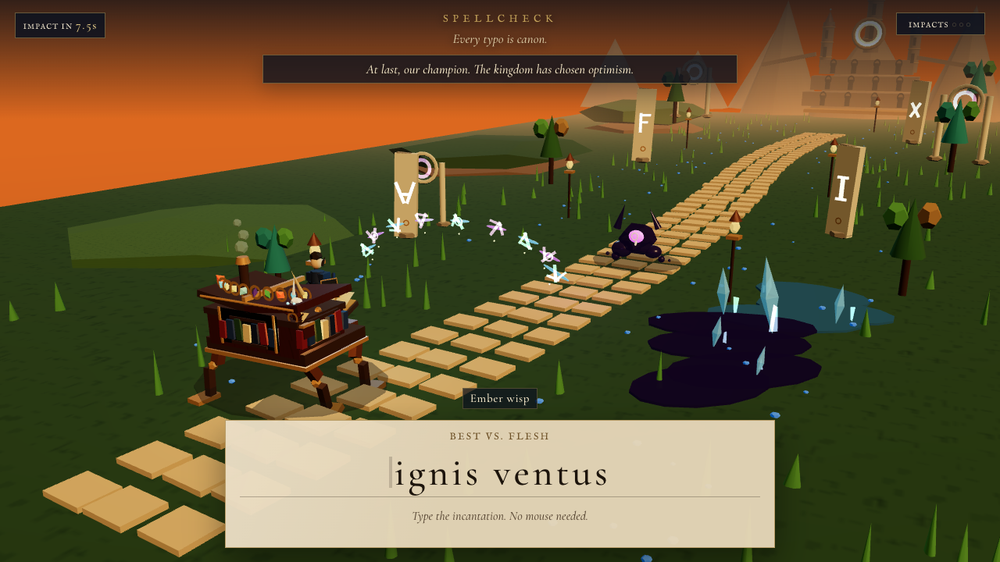
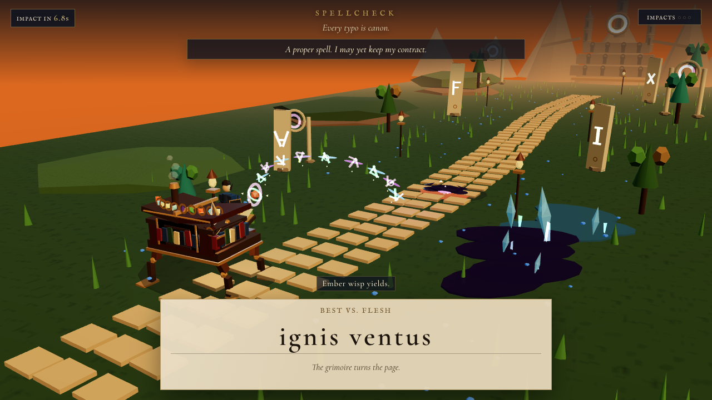
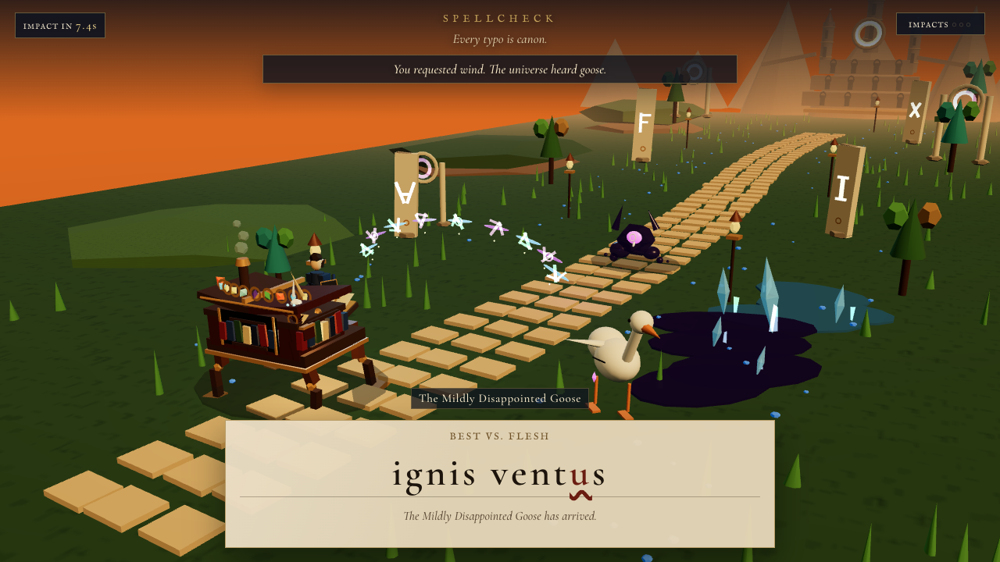
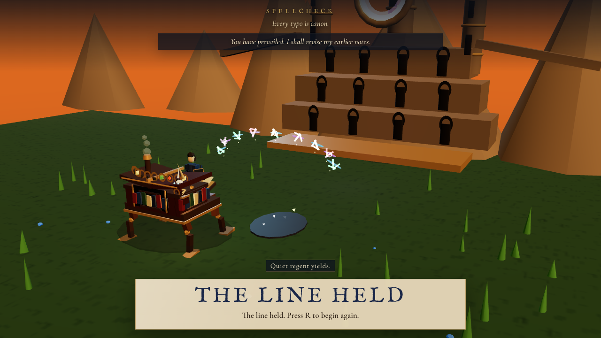
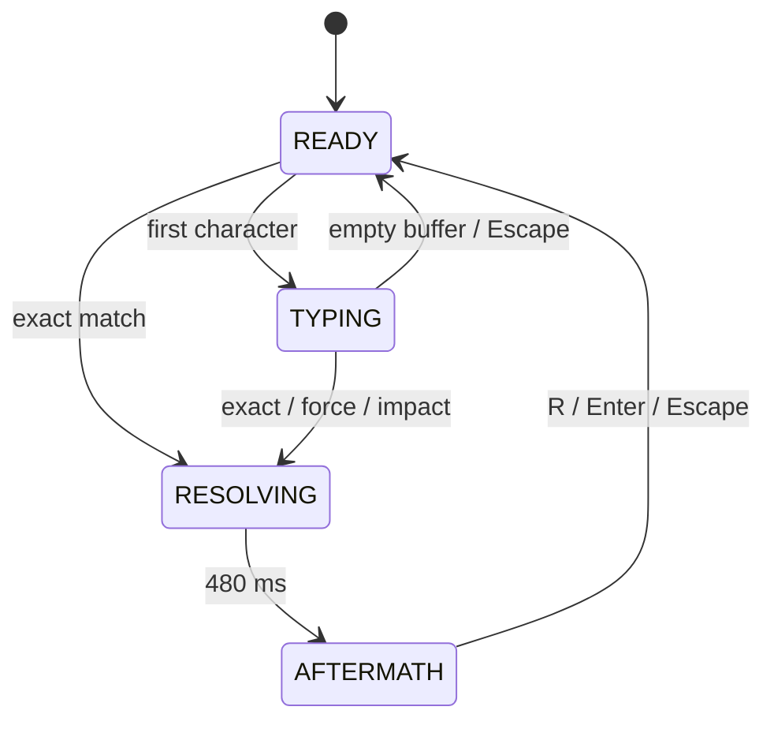

# SPELLCHECK

A keyboard-first fantasy defense game where typing casts spells and typos become cursed magic.

The battle chooses the spell, but the player must type it under pressure. Correct casts change the world and force a tactical rerank. Typos become deterministic cursed magic, and an event-aware bard remembers the mistake and recovery.

## Screenshots

| Opening | Clean cast |
| --- | --- |
| <br>The frontier awaits a spell | <br>A clean cast lands |
| <br>A typo summons the goose | <br>Six threats, the line held |

## How to play

- Type the visible prompt. Exact completion auto-casts; no Enter needed.
- Typos become cursed magic. Type `ignis ventis`, then press Enter to summon the Mildly Disappointed Goose. Backspace repairs letters; Escape clears the buffer.
- Follow the new recommendation after each cast. Cooldown and spell availability drive the rerank; spent spells stay unavailable for the run.
- Defeat six threats to win. Three unmitigated hits lose the run. Press `R` at either ending to restart.
- Add `?flat=1` to the URL for the CSS fallback.

## How it was built

Built by Brenden Mendez in three days at a Cursor hackathon (August 2026).

The work started with specs in [docs/ready/](docs/ready/): product, state architecture, contracts, and a decision ledger. Agents implemented against acceptance tests. Brenden set scope, reviewed the work, and made the decisions.

> Agents authored and validated the spell corpus, deterministic ranker, and event-aware bard, plus a bundled local voice pack with browser fallback; this build needs no runtime model.

## Verification (as recorded 2026-08-18)

These results were recorded in docs/CHECKPOINT.md, in the [presentation release recheck and final independent release gate](docs/CHECKPOINT.md). They are historical results, not a new test run.

| Check | Recorded result |
| --- | --- |
| Production build | Exit 0 |
| Unit tests | 33/33 pass |
| Playwright browser tests | 19/19 pass (16 UX + 3 audio) |
| Final QA run | 0 console errors, 0 failed requests, 0 remote requests |
| Secret-leak check | Passed; `.env` untracked and absent from `dist` |

The recorded release remained conditional on human audio and usability checks.

## Architecture

One in-memory reducer owns combat state. The DOM renders the prompt and HUD. The canvas renders the world.

The phase transitions below follow [the state architecture document](docs/ready/03-state-architecture.md):



Narration falls back from generated clip → browser speechSynthesis → subtitle; there is no server, no runtime model.

## Run it locally

```sh
npm install
npm run dev
```

Run the unit and browser tests:

```sh
npm test
npx playwright test
```

Build and preview:

```sh
npm run build && npm run preview
```

3D costume models are optional local assets not included in the repo. The game runs without them. Add `?flat=1` to the local URL to force the CSS fallback.

## Credits

- Cormorant Garamond and IM Fell English fonts: SIL Open Font License 1.1. Font files and licenses are in [public/fonts/](public/fonts/): [Cormorant Garamond license](public/fonts/OFL-CormorantGaramond.txt), [IM Fell English license](public/fonts/OFL-IMFellEnglish.txt).
- Bard voice clips generated with ElevenLabs.
- React, React Three Fiber, three.js, Vite, Playwright.

[Brenden's portfolio](https://brenden-mendez.vercel.app) · [GitHub profile](https://github.com/mendez671)
