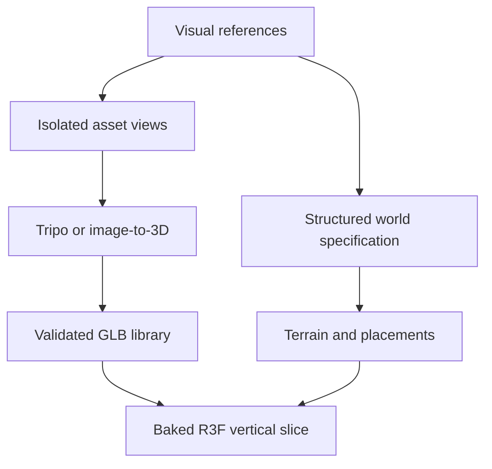

# SPELLCHECK — 2D-to-3D Asset and World Generation Strategy

## Index

1. Executive conclusion
2. The accurate mental model
3. Capability comparison
4. Tripo: what it actually adds
5. WorldClaw: research system versus runnable implementation
6. Why this was the missing production layer
7. Recommended hybrid pipeline
8. How to prepare the existing visual references
9. Exact applications inside SPELLCHECK
10. WorldSpec adaptation for the one-mode game
11. R3F ingestion and runtime architecture
12. Generated-asset quality gates
13. Risks and hidden assumptions
14. Costs, latency, and workflow economics
15. Three-stage pilot plan
16. Expansion opportunities after the vertical slice
17. Final recommendation
18. Agent-ready implementation directive
19. Sources

## 1. Executive conclusion

These tools add a genuinely important missing layer, but not in quite the same way.

- **Tripo is an asset compiler.** It can turn a clean single-object image or multiview reference into a mesh, texture it, retopologize it, rig eligible characters, apply animations, and export formats such as GLB that fit a web/R3F workflow. Its official API supports text, image, and multiview generation plus model processing and animation stages. [Tripo developer overview](https://developers.tripo3d.ai/en)
- **WorldClaw is a world-planning and composition architecture.** It converts an open-ended prompt into structured regions, terrain, reusable assets, materials, and placements, then performs render-based inspection and refinement. Its important output is not just a pretty panoramic mesh; it is an explicit terrain plus independently editable object instances. [WorldClaw paper](https://arxiv.org/html/2608.05248v1)
- **fal-worldclaw is a practical R3F-adjacent reimplementation.** It miniaturizes the research design into a Next.js/React Three Fiber browser application using fal-hosted models, deterministic TypeScript terrain and placement code, a JSON world specification, generated GLBs, and a vision critique step. [fal-worldclaw repository](https://github.com/blendi-remade/fal-worldclaw)

The recommended production pattern is:

> **Generate → validate → optimize → bake → ship.**

Use generation while building the game. Do not make world generation a dependency of the player’s runtime experience.

The most valuable immediate move is not “generate the entire open world.” It is:

1. Convert a few carefully prepared concept assets into usable GLBs.
2. Borrow WorldClaw’s structured world-planning ideas for one authored route.
3. Freeze the successful outputs into the game repository.
4. Let the R3F runtime handle deterministic gameplay, typing, encounters, cooldowns, bard timing, camera behavior, and spell reactions.

This expands the visual ambition without weakening the one-mode invariant:

> The world presents a phrase; the player types; the world responds.

## 2. The accurate mental model

The three links do not represent three equivalent “2D image to 3D world” tools.

### Tripo

Input:

- Text prompt.
- One isolated image.
- Multiple reference views.
- An existing mesh for selected processing operations.

Output:

- A 3D asset: generally one character, creature, prop, structure, or object.
- Geometry plus optional textures/PBR maps.
- Optional processed forms such as retopologized, segmented, rigged, or animated models.

Best unit of work:

> One object with a clear silhouette.

### Tencent WorldClaw

Input:

- One open-ended description of a large scene or world.

Output:

- Structured scene specification.
- Region-aware terrain.
- Materials.
- Reusable object prototypes.
- Independent placements.
- Refined object–terrain contacts.
- A world that remains editable at the instance level.

Best unit of work:

> One structured environment composed from terrain and many objects.

### fal-worldclaw

Input:

- One scene prompt and generation settings.

Output:

- A live Three.js/R3F world.
- Seeded terrain and procedural scatter.
- Generated material textures and hero GLBs.
- Instance transforms and world-spec JSON.
- A browser editor and diagnostic views.

Best unit of work:

> One compact generated diorama or world blockout.

### The combined model



Tripo and WorldClaw are complementary. One creates the nouns; the other organizes the landscape and spatial relationships around those nouns.

## 3. Capability comparison

| Question | Tripo | Tencent WorldClaw | fal-worldclaw |
|---|---|---|---|
| Primary purpose | Individual 3D asset generation and processing | Research framework for large explicit worlds | Browser-scale reimplementation of the research pattern |
| Typical input | Text, single image, or multiview | Open-ended world prompt | Open-ended world prompt |
| Typical output | GLB/FBX/OBJ and related 3D formats | Terrain plus editable textured meshes and transforms | R3F scene plus world-spec JSON and asset URLs |
| Terrain generation | No | Yes | Yes, deterministic TypeScript height field |
| Object generation | Yes | Yes, through image and 3D backbones | Yes, through fal endpoints |
| Placement reasoning | No world-scale placement system | Yes | Yes, LLM plan plus deterministic solver |
| Materials | Asset textures and PBR | Generated and procedural terrain materials | fal Patina materials plus region splat shader |
| Rigging/animation | Supported for eligible assets | Not the central contribution | Not implemented as a core world stage |
| R3F proximity | GLB output is suitable for Three.js/R3F | Primarily Blender in the reported experiments | Already built with R3F, Drei, Three.js, Zustand |
| Runtime suitability | Generated results should normally be baked | Research pipeline is too heavy for player runtime | Useful as build tooling or prototype generator, not core gameplay runtime |
| Best SPELLCHECK use | Hero, bard, enemies, Scriptorium, landmark props | World-schema ideas and environment generation | Reference implementation, world blockout, or build-time generator |

## 4. Tripo: what it actually adds

### 4.1 End-to-end asset workflow

Tripo’s current developer stack exposes generation, texturing, segmentation, retopology, conversion, rig checks, rigging, and animation retargeting as composable API stages. Generation is asynchronous: a request returns a task ID, and the result is later queried or delivered through an appropriate task workflow. The official quick start returns a GLB URL and notes that temporary model URLs expire quickly, so generated files must be downloaded into owned storage promptly. [Tripo quick start](https://developers.tripo3d.ai/en/docs/quick-start)

For SPELLCHECK, that means a build agent could implement an asset job such as:

1. Upload an isolated Cooldown Golem image.
2. Generate a textured model.
3. Run a retopology or smart-low-poly pass.
4. Normalize scale and pivot.
5. Export/download GLB.
6. Validate it locally.
7. Commit the accepted result into the static game assets.

### 4.2 Why multiview matters

A single image forces a model to invent everything it cannot see: the back, underside, thickness, intersections, and hidden attachment points. Tripo’s own guidance recommends clean lighting and multiple angles for stronger reconstruction; its multiview API can accept consistent views and exposes face limits, PBR options, deterministic seeds, automatic real-world sizing, and geometry compression controls. [Tripo input-image guidance](https://www.tripo3d.ai/tutorials/tripo-ai-best-image-types) [Tripo multiview API](https://developers.tripo3d.ai/en/docs/generation-multiview-to-model/p)

This changes how our reference art should be produced. A beautiful bestiary lineup is useful for art direction but poor as a direct 3D-generation input. Each creature should become its own isolated reference package.

### 4.3 Retopology and browser budgets

Generated meshes can be visually appealing while still being inefficient or difficult to animate. Tripo exposes basic decimation and a smart retopology pathway. Its documented smart-retopology limits are appropriate for deliberately constrained game assets rather than cinematic source geometry. [Tripo retopology documentation](https://developers.tripo3d.ai/en/docs/mesh-decimate)

Recommended first-pass budgets for this particular stylized R3F vertical slice are design targets, not universal rules:

| Asset class | Pilot triangle target | Texture target | Notes |
|---|---:|---:|---|
| Typomancer | 8k–15k | 1K–2K | Only one on screen; rig quality matters more than micro-detail |
| Bard familiar | 3k–8k | 1K | Small screen footprint; preserve face/eye readability |
| Scriptorium | 10k–20k | 1K–2K | Prefer separable moving pieces and reusable materials |
| Golem or elite enemy | 5k–10k | 1K | Strong silhouette; repeated instances should remain limited |
| Imp or goose | 2k–6k | 512–1K | Small, fast, and visually simple |
| Archive landmark | 10k–25k | 1K–2K | Background silhouette can carry more importance than close detail |
| Repeated props | 300–3k | 256–1K | Reuse geometry/materials and instance whenever practical |

Final budgets should be set from measurements on the target devices, not from the table alone.

### 4.4 Character and creature animation

Tripo documents a game-character workflow consisting of image-to-model, rig check, auto rig, and animation retargeting. The service can recommend a rig type and apply preset animations to eligible models. [Tripo character workflow](https://developers.tripo3d.ai/en/docs/quick-start) [Tripo rig check](https://developers.tripo3d.ai/en/docs/animations-rig-check)

This helps with:

- Typomancer idle and basic locomotion if locomotion remains visually useful.
- Bard hover or gesture foundations.
- Golem walk and hit reactions.
- Imp approach and defeat motions.

It does not automatically solve:

- Typing specifically on the rune grimoire.
- Hand alignment with a lectern.
- Character-to-Scriptorium contact.
- Spell timing synchronized to exact keystrokes.
- Comedic performance beats for bard delivery.

Those should remain procedural, authored, or layered on top of a generic rig. For the hackathon, the safest approach is to use short generic animations and drive hands, head, grimoire glow, and bard reactions procedurally.

### 4.5 Pricing and rights

Tripo’s API currently lists usage-based pricing at one cent per credit. Image-to-3D and multiview-to-3D have base credit costs, with additional charges for texture quality, geometry quality, low-poly processing, parts, retopology, and animation. API and Studio billing are separate. [Tripo API pricing](https://developers.tripo3d.ai/en/pricing)

The terms distinguish free and paid users. As written, paid users generally receive broad rights to their inputs and outputs, subject to law, the agreement, and the service’s retained license necessary to provide the service; free-user outputs are treated differently. The terms also say outputs may not be unique and place responsibility for input rights and output review on the user. This is not legal advice, but it is enough to justify three operating rules: use a paid tier for assets intended for commercial distribution, use only original references, and archive the applicable terms plus generation records. [Tripo terms](https://www.tripo3d.ai/terms)

## 5. WorldClaw: research system versus runnable implementation

### 5.1 Tencent’s WorldClaw research design

WorldClaw’s core insight is that a coherent world does not have to be generated everywhere at once. It first creates shared global constraints and terrain, then selectively adds local detail. Its stages are:

1. Intent analysis and scene planning.
2. Global terrain generation.
3. Regional object generation and placement.
4. Render-guided refinement.

The paper’s structured specification includes regions, terrain constraints, object requirements, materials, densities, spatial relationships, and numeric terrain parameters. It generates semantic layout maps, height fields, reusable asset prototypes, terrain materials, region compositions, individual object reconstructions, and placement transforms. [WorldClaw method](https://arxiv.org/html/2608.05248v1)

The result is valuable because the world remains explicit:

- Terrain is geometry.
- Objects are separate meshes.
- Placements are transforms.
- Materials are editable.
- Instances can be replaced or reused.

That is far more useful for a game than a single panoramic image, video, or opaque scene splat.

### 5.2 Research-pipeline requirements

The reported implementation uses Claude Opus 4.8, GPT-Image-2, SAM3, SAM3D, Hunyuan3D, Blender 5.1.1, and a server with four NVIDIA H20 GPUs. The paper acknowledges that the pipeline is expensive, long-horizon, model-dependent, and vulnerable to errors in generated Blender code, scale, node connectivity, placement, and object–terrain contact. [WorldClaw implementation and limitations](https://arxiv.org/html/2608.05248v1)

Therefore:

> The Tencent research pipeline is an architectural reference, not a sensible direct dependency for this game’s runtime or near-term hackathon build.

### 5.3 fal-worldclaw’s practical simplification

The `fal-worldclaw` repository recreates much of the architecture in a browser-oriented stack:

- Next.js.
- React Three Fiber and Drei.
- Three.js.
- Zustand.
- fal’s model endpoints.
- Seeded TypeScript terrain and placement.
- A JSON-serializable `WorldSpec`.

Its stages are:

1. Extract explicit prompt constraints.
2. Ask an LLM to author `WorldSpec` JSON.
3. Build a seeded region-aware height field in TypeScript.
4. Solve object placements deterministically.
5. Generate region materials.
6. Generate hero concept images and reconstruct GLBs.
7. Screenshot the world and let a vision model order bounded corrections.

The repository’s own README describes the default world as taking a few minutes and approximately $0.40–$0.70 in fal credits, with a faster SAM-3D asset path and a higher-quality Hunyuan path. Official fal pages currently list SAM 3D object reconstruction at $0.02 per unit and Hunyuan 3D Pro at a materially higher per-generation cost plus add-ons. [SAM 3D on fal](https://fal.ai/models/fal-ai/sam-3/3d-objects) [Hunyuan 3D Pro on fal](https://fal.ai/models/fal-ai/hunyuan-3d/v3.1/pro/image-to-3d)

### 5.4 What fal-worldclaw gets right for SPELLCHECK

- Its planner writes a bounded schema instead of free-form scene prose.
- The terrain and placement stages are deterministic after planning.
- Repeated vegetation and rocks use cheap procedural prototypes.
- Unique “hero” assets use generation only where distinctiveness matters.
- Failures degrade to procedural geometry instead of stopping the whole world.
- World assembly streams progressively.
- Diagnostic appearance, instance, normal, and depth views make failure visible.
- Render critique is restricted to a known correction vocabulary rather than unrestricted code mutation.
- The output can be exported as world-spec JSON with asset URLs and instance transforms.

### 5.5 What should not be copied blindly

- Its default experience includes orbit, first-person WASD, click selection, and editing gizmos. Those are useful authoring features, not SPELLCHECK player controls.
- Its planner favors compact dioramas filled with many objects. SPELLCHECK needs a legible encounter corridor and stable typing focal area; density must never obscure prompts or threats.
- Generated hero meshes may be far too large for a web game. One official fal Hunyuan example GLB shown on its model page is tens of megabytes, demonstrating why generated output must be optimized before shipping. [Hunyuan 3D Pro output example](https://fal.ai/models/fal-ai/hunyuan-3d/v3.1/pro/image-to-3d)
- Its current refinement vocabulary mainly changes prototype scale, removes instances, and adjusts fog/sun settings. It does not validate gameplay lanes, phrase readability, enemy timing, collision, or spell interaction zones.
- The inspected repository commit did not contain a license file or a package license declaration. Treat the code as reference-only until the author publishes a license or grants permission. Do not assume that public GitHub visibility equals permission to copy or redistribute.

## 6. Why this was the missing production layer

The project already had:

- A game loop.
- A one-mode input contract.
- A spell grammar.
- Bard personality and commentary.
- A spatial world thesis.
- Character, world, and enemy concept references.
- A vertical-slice asset list.

What it did not yet have was a reliable bridge between **visual concept** and **runtime scene**.

That bridge can be named more precisely:

> **Assetization and world compilation.**

Assetization turns a visual idea into a bounded, inspectable runtime object:

- Mesh.
- Texture/material.
- Scale.
- Pivot.
- Rig if needed.
- Animation if needed.
- Collider proxy.
- LOD or simplified form.
- Provenance record.

World compilation turns art direction into a structured spatial package:

- Regions.
- Route.
- Terrain.
- Landmarks.
- Encounter anchors.
- Object prototypes.
- Instance transforms.
- Camera-safe areas.
- Spell-reaction surfaces.

Tripo can accelerate assetization. WorldClaw provides a model for world compilation.

## 7. Recommended hybrid pipeline

### Stage A — Preserve the game specification

Treat the canonical game and R3F design documents as upstream constraints. Generation tools are implementation aids, not new creative directors.

Locked invariants:

- One player-facing mode.
- Typing is always the control language.
- The camera and prompt remain readable.
- The game is a continuous authored journey, not empty free roaming.
- The bard is embodied in the world.
- Spells visibly change the environment.

### Stage B — Prepare isolated asset references

Create one reference package per asset:

- Clean neutral background.
- Entire object visible.
- Consistent proportions across views.
- Uniform lighting.
- Minimal cast shadow.
- Front, side, back, and three-quarter views where practical.
- Neutral pose for anything that must be rigged.

### Stage C — Generate only high-value unique assets

Initial candidates:

1. Cooldown Golem.
2. Misfire Goose.
3. Scriptorium.

These test three different failure domains:

- Golem: non-humanoid topology and animation.
- Goose: recognizable organic form and comedy.
- Scriptorium: complex prop with mechanical pieces and scale/pivot requirements.

The Typomancer should come later because character rigging, hands, clothing, and a waist-mounted grimoire create more failure surfaces.

### Stage D — Validate and optimize outside the runtime

Each accepted GLB should pass an asset intake process:

- Visual review from front/back/side/top.
- Geometry and material inventory.
- Triangle count.
- Texture count and dimensions.
- File size.
- Normal/tangent correctness.
- Scale and pivot.
- Animation and skeleton check.
- Collider or interaction proxy.
- Runtime load test.
- Provenance and license record.

### Stage E — Build a SPELLCHECK-specific world spec

Use a WorldClaw-like schema to describe one route, but add gameplay semantics that ordinary world generators do not understand.

### Stage F — Generate or procedurally construct the environment shell

Use procedural terrain, repeated props, generated materials, and a small number of unique landmarks. Keep enemy lanes and typing focal areas authored.

### Stage G — Bake the approved result

Save accepted models, textures, world JSON, and transforms into the project. The deployed game should not depend on temporary CDN links, generation queues, external model availability, or player-supplied API keys.

### Stage H — Run the game deterministically

At runtime:

- Load local GLBs.
- Instantiate repeated assets.
- Execute combat and spell logic locally.
- Drive the bard from the pre-baked corpus.
- Preserve seeded decorative variation only where it cannot affect fairness or typing readability.

## 8. How to prepare the existing visual references

### Image 01 — Typomancer and bard sheet

Current role:

- Strong art-direction reference.
- Weak direct image-to-3D input because it contains several character views, bard variants, equipment closeups, and multiple objects in one canvas.

Required transformation:

1. Export the Typomancer as a separate clean subject.
2. Create consistent front, side, back, and three-quarter views.
3. Put the body in a neutral riggable pose.
4. Separate the grimoire/keyboard as its own object if it must animate independently.
5. Create the bard as a separate asset package.
6. Decide whether the lectern belongs to the bard, Scriptorium, or world prop; do not fuse all three.

### Image 02 — Lexicon Frontier keyframe

Current role:

- Excellent scene thesis, camera, palette, landmark, route, and world-memory reference.
- Poor input for one-click reconstruction of the entire world.

Recommended use:

- Feed it to a planning or vision agent as art direction.
- Derive a top-down semantic layout from it.
- Extract individual landmark concepts from it.
- Use its visual hierarchy to author the world spec.
- Do not treat the image as a promise that a single generated mesh will be playable.

### Image 03 — Enemy bestiary

Current role:

- Strong family language and relative scale reference.
- Not directly usable as one asset-generation input because it contains six subjects.

Required transformation:

- Crop or regenerate each enemy separately.
- Create consistent multiview references per enemy.
- Preserve the shared black-violet corruption material.
- Keep the Goose visually ordinary enough that its arrival remains absurd.

### New reference images worth creating

1. Scriptorium clean multiview sheet.
2. Archive landmark isolated sheet.
3. Cooldown Golem neutral multiview sheet.
4. Misfire Goose neutral multiview sheet.
5. Modular route-kit sheet: road, edge, bridge, rune monolith, archive fragments.
6. Material board: parchment stone, ink water, copper, carved wood, rune glow, corruption.
7. Top-down semantic layout image with route and encounter zones.

## 9. Exact applications inside SPELLCHECK

### 9.1 Typomancer

Use Tripo when:

- A clean multiview reference exists.
- The model is generated in a neutral pose.
- The result passes a rig check.
- The clothing does not fuse arms to the body.

Keep procedural/authored:

- Keystroke reactions.
- Hand placement over the grimoire.
- Cast timing.
- Hit timing.
- Face direction toward the active threat.

### 9.2 Bard

The bard is an especially good 2D-to-3D candidate because it can float and therefore avoids foot contact, walk cycles, and ground navigation. It should be modeled as a small number of independently controllable pieces:

- Core body/head.
- Eye or face plate.
- Quill.
- Lute or musical element.
- Optional book/lectern perch.

Procedural rotation, hover, squash, eye expression, and instrument strum can create a surprising amount of personality without a sophisticated skeleton.

### 9.3 Scriptorium

This is a high-value but high-risk generation target.

Generation can provide:

- Base wagon/body silhouette.
- Wood/copper/parchment material concept.
- Bookish mechanical details.

The development agent should probably rebuild or separate:

- Legs/wheels.
- Lectern.
- Cooldown rune mounts.
- Player standing point.
- Bard perch.
- Collider.

The generated mesh should be treated as a visual shell, not an interaction-ready machine.

### 9.4 Enemies

Use generated GLBs for unique silhouettes, but make gameplay state explicit through simple overlays:

- Inkblot Imp: base mesh plus procedural ink particles.
- Cooldown Golem: base mesh plus separate rotating glyph plates.
- Redaction Hound: base hound mesh plus animated censor-band ribbons.
- Homophone Harpy: base mesh plus mirrored head/quotation features.
- Syntax Wyrm: modular segment asset instanced along a spline.
- Misfire Goose: simple base mesh plus a crooked charm and authored honk reaction.

This separates difficult identity generation from cheap runtime expressiveness.

### 9.5 World and route

Use WorldClaw ideas for:

- Region boundaries.
- Terrain height field.
- Ink river.
- Archive landmark placement.
- Monolith distribution.
- Reusable rocks, foliage, parchment fragments, and ruins.
- Material zones.
- Seeded decorative scatter.

Keep hand-authored:

- Scriptorium route spline.
- Encounter start/end points.
- Enemy approach lanes.
- Camera framing.
- Prompt anchor.
- Obstacle and route-choice timing.
- Spell-reaction surfaces.

### 9.6 Spells and world memory

Image-to-3D is generally unnecessary for short-lived spell effects. Use particles, decals, shaders, instanced fragments, and a small library of procedural meshes.

Generation may help with persistent objects such as:

- Raised earth barrier.
- Ice crystal ridge.
- Revealed rune shrine.
- Summoned comic object.

The important distinction is that a spell effect is behavior first and geometry second.

## 10. WorldSpec adaptation for the one-mode game

WorldClaw’s world schema is useful but insufficient for SPELLCHECK. Add game-specific fields.

```json
{
  "route": {
    "spline": [[0, 0, 0], [20, 1, -15]],
    "travelSpeed": 2.4,
    "cameraSafeWidth": 18
  },
  "encounters": [
    {
      "id": "ink-gate-01",
      "routeT": 0.32,
      "enemyLaneIds": ["center", "right"],
      "promptAnchorId": "prompt-01",
      "recommendedSpellPool": ["ignis ventus", "glacies terra"],
      "worldReactionZoneIds": ["ink-river-a"]
    }
  ],
  "legibilityZones": [
    {
      "id": "prompt-01",
      "keepClearRadius": 7,
      "maxBackgroundLuminance": 0.55
    }
  ],
  "reactionZones": [
    {
      "id": "ink-river-a",
      "accepts": ["fire", "ice", "wind", "earth"],
      "memoryDurationSeconds": 20
    }
  ]
}
```

Additional recommended fields:

- `routeChoices`: typed route phrases and branch destinations.
- `enemyLanes`: origin, target, speed range, and camera priority.
- `promptAnchors`: stable world-space transform and fallback screen-space position.
- `cameraBeats`: framing rules at landmarks and encounters.
- `bardAnchors`: perch positions and allowed reaction volumes.
- `cooldownAnchors`: in-world locations of spell-status objects.
- `collisionPolicy`: simplified collider type per prototype.
- `assetBudgets`: triangle, texture, material, and instance limits.
- `provenance`: generation tool, model version, input references, date, rights status.

The world generator may propose these fields, but validation code must clamp and repair them before runtime use.

## 11. R3F ingestion and runtime architecture

### 11.1 Build-time asset registry

Every accepted generated asset should enter a registry:

```json
{
  "id": "cooldown-golem-v1",
  "url": "/assets/models/cooldown-golem-v1.glb",
  "source": "tripo",
  "scaleMeters": 3.8,
  "pivot": "center-bottom",
  "collider": "capsule",
  "maxInstances": 2,
  "lod": {
    "near": "/assets/models/cooldown-golem-v1.glb",
    "far": "/assets/models/cooldown-golem-v1-low.glb"
  }
}
```

### 11.2 Runtime separation of concerns

| Layer | Owns |
|---|---|
| Content data | Spell corpus, bard corpus, enemy definitions, world spec |
| Game state | Typing buffer, encounter state, cooldowns, recommendations, score |
| World state | Route progress, enemy transforms, reaction zones, temporary world memory |
| Rendering | GLB instances, particles, decals, materials, lighting, camera |
| Build pipeline | Generation, download, validation, optimization, provenance |

Do not let generated meshes own game logic. A Golem mesh is presentation; the Golem state machine remains deterministic code.

### 11.3 Performance rules

- Reuse geometry and materials.
- Instance repeated props and environmental scatter.
- Use simplified colliders rather than mesh colliders.
- Avoid loading all biome assets before the slice needs them.
- Use distance-based detail and visibility control.
- Compress geometry and textures after measuring visual loss.
- Keep temporary spell marks bounded and recyclable.
- Keep frame-loop state out of React render churn.

These rules align with official R3F guidance on reuse, instancing, LOD, adaptive performance, and avoiding high-frequency React state updates. [R3F scaling guidance](https://r3f.docs.pmnd.rs/advanced/scaling-performance) [R3F performance pitfalls](https://r3f.docs.pmnd.rs/advanced/pitfalls)

### 11.4 Asset URLs

Never ship temporary generator URLs as production asset references. Tripo’s quick start explicitly warns that returned model URLs expire after a short period. Download and version every accepted asset. [Tripo quick start](https://developers.tripo3d.ai/en/docs/quick-start)

## 12. Generated-asset quality gates

An asset is not accepted because it looks good in one thumbnail.

### Gate A — Identity

- Recognizable silhouette at gameplay distance.
- Matches the assigned language-corruption concept.
- Fits the storybook arcane frontier.
- Does not resemble an unrelated known franchise or character.

### Gate B — Geometry

- No obvious holes, inverted surfaces, or fused limbs.
- Back and underside are plausible.
- Separate parts exist where animation requires them.
- Scale and pivot are predictable.
- Bounds are not inflated by stray vertices.

### Gate C — Materials

- Texture files exist and load correctly.
- Color-space handling is correct.
- Normal/roughness/metalness channels behave plausibly.
- Texture size is justified by screen footprint.
- Visual style is coherent across assets generated in different jobs.

### Gate D — Animation

- Rig check passes when required.
- Joint weights do not collapse clothing or accessories.
- Root motion is either intentional or removed.
- Loop transitions are acceptable.
- Gameplay events can trigger at deterministic animation times.

### Gate E — Runtime

- No console errors.
- Load time is acceptable on a cold cache.
- Frame time remains within the chosen target on representative devices.
- Draw calls, triangles, and texture memory remain inside the scene budget.
- Repeated instances do not duplicate materials unnecessarily.

### Gate F — Gameplay legibility

- The asset does not cover the active phrase.
- Emissive details do not compete with prompt color coding.
- Enemy orientation and state are visible.
- Defeat and hit reactions remain readable without camera chaos.

### Gate G — Provenance and rights

- Original input reference is archived.
- Tool, model/version, account tier, date, and task ID are recorded.
- Applicable terms are archived or linked.
- No third-party copyrighted character or logo was used as input.
- Commercial-use status is known.

## 13. Risks and hidden assumptions

| Risk | Why it matters | Mitigation |
|---|---|---|
| A concept sheet equals a usable generation input | Multi-subject sheets confuse reconstruction | Isolate one subject and create consistent multiviews |
| “Production-ready” means game-ready | A textured mesh may still lack clean topology, pivot, collider, rig, LOD, and metadata | Enforce intake gates and local optimization |
| Full-world generation saves time | Dense generated scenes can create more cleanup than a small authored route | Generate the environment shell; author gameplay-critical space |
| Visual coherence survives independent jobs | Separate generations can drift in proportion, palette, and material response | Lock prompt templates, seeds where supported, palette, and shared material rules |
| More detail improves the game | High-detail assets may obscure the prompt and reduce web performance | Judge at gameplay distance and preserve legibility first |
| Generated animation fits the mechanic | Generic walk/idle presets do not equal typing or spell performance | Layer procedural and authored animation over the base rig |
| A public repository is reusable | Public code without a stated license may not grant redistribution rights | Seek a license/permission or reimplement the architectural ideas independently |
| API output remains available | Generator CDN links may expire or providers may change | Download, hash, version, and store accepted outputs immediately |
| The world generator understands fairness | Scene planners optimize appearance, not typing difficulty or threat visibility | Encode gameplay zones and validate them deterministically |
| Runtime generation increases novelty | Waiting, cost, nondeterminism, moderation, and outages can damage the demo | Use generation during development, then bake |
| One generated world means “open world” | A generated expanse can pull the design away from its focused route | Keep “open-world feeling” as visual depth, not player locomotion scope |
| AI-created assets are automatically exclusive | Providers warn that outputs can be similar or non-unique | Preserve human direction and avoid basing identity on generic output alone |

## 14. Costs, latency, and workflow economics

### Tripo

Official API pricing is task-based. As of this document date, basic textured image-to-3D or multiview generation is inexpensive enough for targeted experimentation, but retopology, higher-detail geometry, 8K textures, part generation, rigging, and animations each add cost. [Tripo API pricing](https://developers.tripo3d.ai/en/pricing)

The important metric is not cost per generation. It is:

> **Cost per accepted asset.**

Track:

- Number of attempts.
- Generation credits.
- Processing credits.
- Human/agent cleanup time.
- Final file size.
- Whether the asset was actually shipped.

### fal-worldclaw

The repository claims a default generated world costs about $0.40–$0.70 and takes a few minutes, but cost depends on scene plan, number of hero assets, mesh engine, queue state, material jobs, and refinement calls. The Hunyuan quality path can cost far more per asset than the SAM-3D path. [fal-worldclaw repository](https://github.com/blendi-remade/fal-worldclaw) [fal Hunyuan pricing](https://fal.ai/models/fal-ai/hunyuan-3d/v3.1/pro/image-to-3d)

Again, use:

> **Cost per accepted world shell**, not cost per run.

### Time economics

Generation only saves time when the output crosses the acceptance gate faster than an alternative. For a stylized R3F vertical slice:

- It will likely save substantial time on unique creature and prop silhouettes.
- It may save moderate time on landmarks and decorative structures.
- It may lose time on the hero character if rigging or clothing fails repeatedly.
- It will likely lose time if asked to generate the whole playable world without a structured cleanup pipeline.

## 15. Three-stage pilot plan

### Pilot 1 — Asset feasibility

Goal:

> Determine whether generated assets can match the visual thesis and run acceptably in R3F.

Inputs:

- Cooldown Golem isolated multiview.
- Misfire Goose isolated multiview.
- Scriptorium isolated multiview.

Procedure:

1. Generate standard textured versions.
2. Choose the best of no more than three attempts per asset.
3. Retopologize or decimate to the pilot target.
4. Download GLB immediately.
5. Normalize scale/pivot.
6. Load all three into an R3F test scene.
7. Add one animation or procedural motion per asset.
8. Record quality, file size, load time, and cleanup time.

Pass condition:

- At least two of three assets are usable after bounded cleanup.
- The total process is materially faster than hand-building comparable placeholders.
- The assets remain readable at actual gameplay camera distance.

### Pilot 2 — World-shell feasibility

Goal:

> Determine whether a WorldClaw-style schema can create a useful Lexicon Frontier blockout without compromising the game.

Procedure:

1. Run `fal-worldclaw` independently with a SPELLCHECK-specific scene prompt if a fal key and test budget are available.
2. Export its world-spec JSON and screenshots.
3. Do not integrate repository code until licensing is clarified.
4. Evaluate terrain shape, route potential, landmark hierarchy, generated asset quality, and density.
5. Translate the useful result into a SPELLCHECK-specific world spec with route and encounter metadata.
6. Freeze a single accepted world shell.

Pass condition:

- The shell reduces environment blockout time.
- A clear Scriptorium route can be authored through it.
- Encounter and prompt legibility zones remain controllable.
- The scene does not require a second exploration mode to justify its size.

### Pilot 3 — Integrated vertical slice

Goal:

> Prove that generated content supports the typing loop instead of merely decorating it.

Required scene:

- Scriptorium traveling along one route.
- One encounter with an Imp or Golem.
- One successful two-root spell.
- One visible environmental reaction.
- One Goose misfire.
- One bard roast synchronized to the error.
- Stable prompt throughout.

Pass condition:

- A first-time player understands the interaction without explanation.
- The generated world makes the result feel more alive.
- Typing remains the dominant action and visual focal point.

## 16. Expansion opportunities after the vertical slice

Only pursue these after the integrated slice passes.

### 16.1 A world-seed library

Generate several world shells at build time and curate the best. Ship them as authored chapters rather than generating them during play.

### 16.2 Region packs

Use the same world schema to produce coherent packs:

- Ink marsh.
- Frozen archive.
- Punctuation canyon.
- Redaction forest.
- Syntax ruins.

Each pack can reuse the same route, encounter, and reaction contracts.

### 16.3 Asset-family generation

Generate controlled variants of one accepted prototype:

- Golem plates.
- Monolith silhouettes.
- Archive fragments.
- Bard instruments.
- Scriptorium attachments.

Variation should preserve collider and anchor contracts.

### 16.4 Spell-created objects

Pre-generate a small set of persistent spell outcomes and summon them during gameplay:

- Ice bridge.
- Earth wall.
- Windmill of letters.
- Burning punctuation barricade.
- Accidental goose monument.

### 16.5 Render-critique as a build check

WorldClaw’s render-inspect-refine idea can become a game-development QA loop:

1. Capture fixed gameplay views.
2. Inspect prompt visibility, enemy separation, palette, and world-memory clarity.
3. Produce bounded recommendations.
4. Require deterministic tests or human approval before applying changes.

This is more valuable than allowing an agent to freely rewrite the scene.

### 16.6 WorldSpec as accumulated design memory

A structured world file can become the durable compression layer connecting:

- Art direction.
- Terrain.
- Asset generation.
- Placement.
- Camera.
- Encounters.
- Spell reactions.
- Performance budgets.
- Provenance.

That makes each future chapter an extension of an explicit grammar rather than a fresh pile of prompts.

## 17. Final recommendation

### Adopt now

- The **generate-validate-bake** workflow.
- A three-asset Tripo pilot using the Golem, Goose, and Scriptorium.
- Multiview asset-reference generation.
- Local GLB storage and an asset registry.
- A WorldClaw-inspired structured world schema.
- Seeded terrain and procedural scatter for background world richness.
- Fixed-view render critique as a build-time QA aid.

### Adopt conditionally

- Tripo rigging for the Typomancer after simpler assets pass.
- fal-hosted image-to-3D if it offers a better asset for a specific cost/quality target.
- Code from `fal-worldclaw` only after a clear license or permission exists.
- Generated world shells only if they save blockout time after cleanup is counted.

### Reject for now

- Runtime world generation.
- One-click reconstruction of the entire world keyframe.
- Generating all 144 spell effects as unique 3D assets.
- Building multiple biomes before one route plays well.
- Adding WASD or click exploration to justify a generated landscape.
- Treating generated GLBs as ready to ship without validation.

### The compressed strategy

> **Generate identity. Procedurally create repetition. Author gameplay space. Bake everything the player depends on.**

## 18. Agent-ready implementation directive

```text
Use the existing SPELLCHECK specifications and visual references as the source of truth. Introduce a build-time 2D-to-3D and world-compilation pipeline without changing the one-mode typing interaction.

First, prepare isolated multiview reference packages for the Cooldown Golem, Misfire Goose, and traveling Scriptorium. Evaluate Tripo or an equivalent image-to-3D service for each asset. Download every successful result immediately, preserve its generation record, and validate silhouette, geometry, materials, scale, pivot, file size, runtime cost, and commercial-use status. Optimize accepted results into locally stored GLBs. Do not allow temporary generator URLs into runtime content.

Second, define a SPELLCHECK-specific WorldSpec inspired by WorldClaw. It must describe terrain regions, route spline, landmark placement, asset prototypes, instance transforms, encounter anchors, enemy lanes, prompt legibility zones, camera-safe areas, cooldown anchors, bard anchors, spell-reaction zones, world-memory duration, asset budgets, and provenance. Use deterministic procedural terrain and scatter for repeated background elements. Keep route, camera, prompt, encounters, and spell-reaction logic authored and testable.

Third, build one integrated R3F slice containing the traveling Scriptorium, one encounter, one correct two-root cast, one persistent environmental reaction, one Goose misfire, and one synchronized bard roast. All player input remains typing. Do not add WASD, click targeting, an exploration mode, or runtime dependency on any 3D-generation service.

Treat generation as a candidate-production process, not as automatic acceptance. If an asset or generated world shell fails its quality, performance, rights, or gameplay-legibility gate, fall back to a procedural placeholder and continue the playable slice.
```

## 19. Sources

### Tripo

- [Tripo developer platform](https://developers.tripo3d.ai/en)
- [Tripo API documentation](https://developers.tripo3d.ai/en/docs)
- [Tripo quick start and game-character workflow](https://developers.tripo3d.ai/en/docs/quick-start)
- [Tripo API pricing](https://developers.tripo3d.ai/en/pricing)
- [Tripo terms](https://www.tripo3d.ai/terms)
- [Tripo input-image guidance](https://www.tripo3d.ai/tutorials/tripo-ai-best-image-types)
- [Tripo multiview-to-model documentation](https://developers.tripo3d.ai/en/docs/generation-multiview-to-model/p)
- [Tripo retopology documentation](https://developers.tripo3d.ai/en/docs/mesh-decimate)
- [Tripo rig-check documentation](https://developers.tripo3d.ai/en/docs/animations-rig-check)

### WorldClaw and fal

- [Tencent WorldClaw project page](https://tencent-hunyuan.github.io/Hunyuan3D-WorldClaw/)
- [WorldClaw paper](https://arxiv.org/html/2608.05248v1)
- [Tencent WorldClaw repository](https://github.com/Tencent-Hunyuan/Hunyuan3D-WorldClaw)
- [fal-worldclaw repository](https://github.com/blendi-remade/fal-worldclaw)
- [SAM 3D Objects on fal](https://fal.ai/models/fal-ai/sam-3/3d-objects)
- [Hunyuan 3D Pro on fal](https://fal.ai/models/fal-ai/hunyuan-3d/v3.1/pro/image-to-3d)
- [Patina materials on fal](https://fal.ai/models/fal-ai/patina/material)

### R3F

- [R3F scaling performance](https://r3f.docs.pmnd.rs/advanced/scaling-performance)
- [R3F performance pitfalls](https://r3f.docs.pmnd.rs/advanced/pitfalls)
