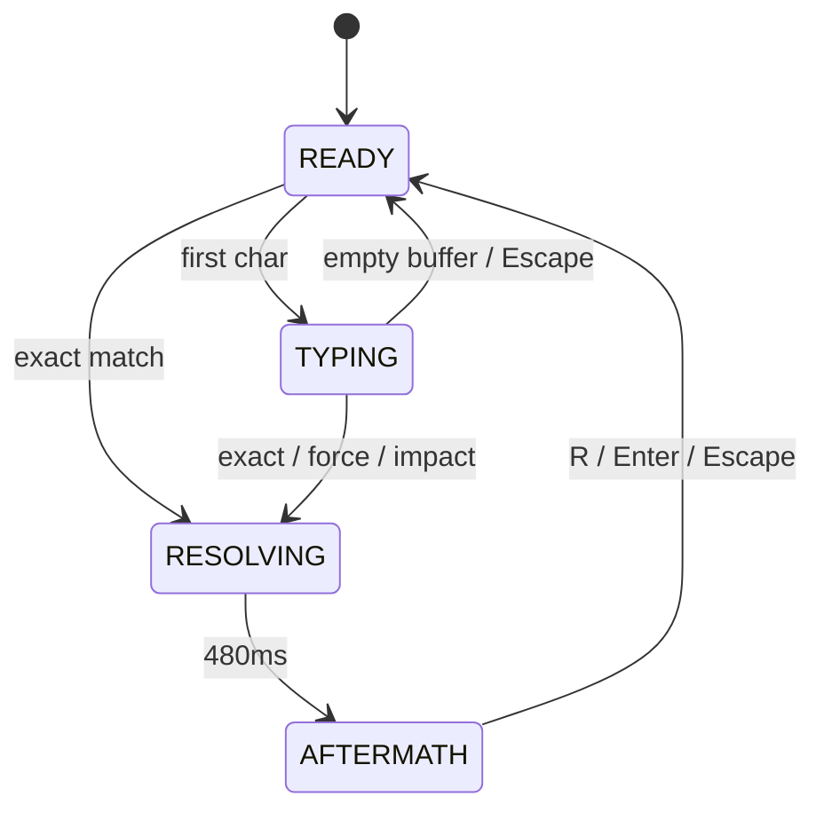

# State architecture

Design target for the working tree. Outcome 1 already owns a single reducer in `src/game/machine.ts`. Extend that file. Do not add a second source of truth.

Pre-audit (DRY): combat truth lives in one reducer. Static content lives in `docs/ready/data/*.json` (copy or import once). HUD reads; it does not invent eligibility.

---

## Layers

### Frontend — Place / Lens / Moment

| Layer | v1 | Why |
|---|---|---|
| **Place** | Single route `/` | One tab, one run. No entity URLs. Refresh starts a new run (no persistence). |
| **Lens** | `?debug=1` inspects machine fields. `?flat=1` skips Canvas when it exists. | Sharable booth fallback. Not a second game. |
| **Moment** | Buffer, caret, lock edge, subtitle visibility, well flash | `useState` / reducer fields. Never `localStorage`. Never URL. |

Refresh/bookmark/share of mid-run combat is **not** a product job. Combat is a Workflow instance that dies with the tab.

### Backend — Resource / Workflow / Step

There is no server.

| Layer | v1 | Storage |
|---|---|---|
| **Resource** | Spell book, roots, bard lines, encounter | Immutable JSON. Presentation must not mutate records. |
| **Workflow** | One run: threats, hits, CDs, phase, bard memory | In-memory reducer. Restart = new instance. |
| **Step** | Keystroke, tick (`dt`), resolve hold timer, audio play | Ephemeral. Timers cancel on phase exit. |

### AI subsystem

No provider router, no stream machines, no LLM cache. Narration is a local Step: clip → `speechSynthesis` → subtitle. Failure cannot stall the Workflow (`D-014`, `A8` anti-pattern: do not collapse combat into `isLoading`).

---

## Live machine (Outcome 1) — do not rename

```ts
type Phase = "READY" | "TYPING" | "RESOLVING" | "AFTERMATH";
```

| Phase | Behavior | Exit |
|---|---|---|
| READY | Show prompt. Empty buffer. May rerank when combat exists. | First committed character → TYPING; exact match → RESOLVING |
| TYPING | Prompt and target frozen. Clock runs (Outcome 2+). Backspace, force, cancel. | Exact auto-cast; Enter dirty; Escape; TTI=0 |
| RESOLVING | Apply outcome once. Keys go to `heldBuffer` (§13.2 explicit buffer). Hold **480 ms**. Clock paused. | `FINISH_RESOLVE` |
| AFTERMATH | Outcome 1: slice ending after the first successful cast. Restart keys live. | `RESTART` or Escape-as-restart |

Outcome 2+ adds `runResult: "won" | "lost" | "none"`, hit counter, threat index, and the per-run spent-spell set (the source field remains `coolingIds` for compatibility). Prefer fields on this machine over a parallel store. A `GAME_OVER` phase is allowed as an alias of AFTERMATH + `runResult` ≠ none (`§13.2`).

Empty buffer during TYPING → READY and unlock (`D-004` commitment ends).

---

## Ownership

| Provider (`§18.5`) | Owns | Must not |
|---|---|---|
| Input | Normalize keys; composition; emit `TYPE` / `FORCE_CAST` / `CANCEL` / `RESTART` | Rank spells; play audio |
| Recommendation | Eligible set + reason | Mutate CDs; talk |
| Resolver | Hits, defeats, misfires, CD writes | Type glyphs |
| Event bus | Append-only `GameEvent[]` this run | Be a second combat store |
| Bard selector | Pick / drop / interrupt lines from events + memory | Drive phase |
| Narration | Play or skip | `await` inside `reduce` |
| Presentation | Render store; dispatch intents | Keep a shadow copy of eligibility |

React components subscribe to the reducer. When a Canvas exists, `useFrame` may call a single `TICK { dt }` action. It must not set phase directly.

---

## Invariants (`§13.3`)

1. One committed prompt.
2. Committed prompt cannot silently change.
3. Spells already spent this run are not recommended as ready.
4. A resolve writes an outcome or a visible fail reason.
5. Buffer and displayed glyphs stay glued (`glyphs(expected, buffer)` is the projection).
6. Narration failure cannot block phase advance.
7. Restart = `createInitialState()` (or equivalent full reset).
8. JSON resources stay immutable at runtime.
9. Exact completion casts **once** (Outcome 1 also caps the slice at one success; lift that cap in Outcome 2+).
10. Canvas never hosts the string to type.

---

## Events (frozen enum)

Use these names (`§13.5`):

`THREAT_APPEARED` · `RECOMMENDATION_CHANGED` · `PROMPT_COMMITTED` · `CHARACTER_CORRECT` · `CHARACTER_INCORRECT` · `CAST_COMPLETED` · `CAST_FORCED` · `MISFIRE_CREATED` · `SPELL_RESOLVED` · `STREAK_REACHED` · `STREAK_BROKEN` · `PLAYER_RECOVERED` · `PLAYER_DEFEATED` · `RUN_WON`

Plus internal: `REPEATED_TYPO` (bard). Do not invent a parallel taxonomy.

---

## Bard memory (slice of the same store)

`totalMistakes`, `correctStreak`, `lastInvalid`, `repeatCount`, `lastSpellId`, `respectBand`, `recentLineIds`, `pendingPriority`. Reset on `RESTART`. Not a profile (`§4.4` out of v1).

---

## Transitions (happy + hostile)



Hostile: unknown keys ignored. Empty Enter no-op. Force on exact no-op. Input during RESOLVING dropped. Tab `preventDefault`. IME: no lock until `compositionend`.

---

## /state-assess — design-time target

**Repo:** `/Users/mndst/cursor-gaming-hackathon-8.18.26`  
**Scope:** architecture + Outcome 1 machine (no claim the shipped game is complete)  
**Date:** 2026-08-18  
**Pre-Audit Discipline:** Followed — extend `machine.ts`; do not mint a second store or a second corpus.

| Check | Target | Notes |
|---|---|---|
| A1 Place | ALIGNED | One `/`. No entity detail without a route. |
| A2 Lens | ALIGNED | Only `debug` / `flat` query. Phase is not a tab. |
| A3 Moment | ALIGNED | Buffer/modals not in URL or `localStorage`. |
| A4 Resource | ALIGNED | JSON read-only; reducer is the single writer of run fields. |
| A5 Workflow | ALIGNED | The run is the workflow. No 4-service await chain. |
| A6 Step | ALIGNED | Timers and ticks are steps; JSON is the resource. |
| A7 Provider | ALIGNED | No LLM SDK. Ranking is a pure function. |
| A8 Lifecycle | ALIGNED | Phase union, not `isLoading`. Audio abort on restart. |
| A9 LLM cache | ALIGNED | Absent. |
| A10 App cache | ALIGNED | No cache-as-truth. |
| A11 Queue | ALIGNED | In-process events. No dual-write. Bard drops stale; no FIFO joke queue. |
| A12 Backpressure | ALIGNED | Critical path is local. No unbounded fetch. |
| A13 Observability | TARGET | `?debug=1` shows phase, prompt, lock, CDs, reason, last events, bard pick. Avoid `console.log` as the only inspect. |
| A14 DRY | TARGET | One `reduce`. One book. Glyph projection stays a function. |

**Overall target: ALIGNED** if Outcome 2+ extends the existing reducer. **DRIFT** if a second Zustand store or a Canvas-owned prompt appears.

### Anti-patterns to refuse

- Prompt inside drei `Html` / WebGL text.
- `localStorage` “bard remembers you.”
- Ranking inside a React effect that fights the reducer.
- `await fetch(tts)` in the resolve path.
- Duplicate `GameState` types in HUD and well.
